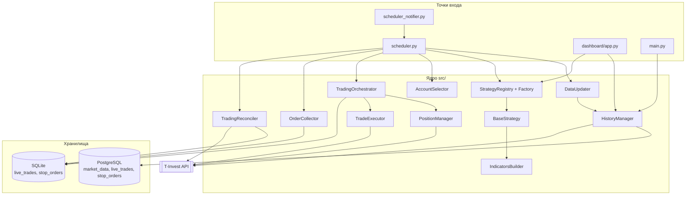
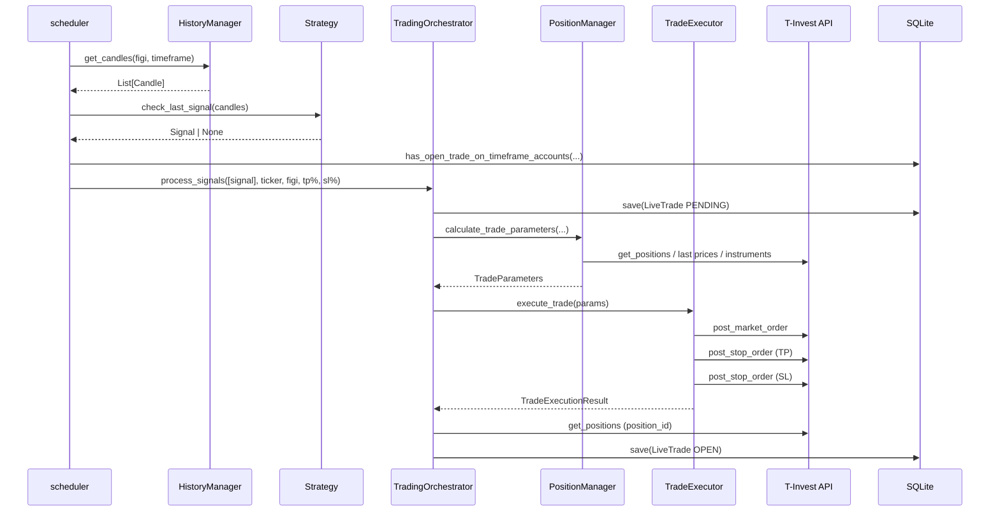
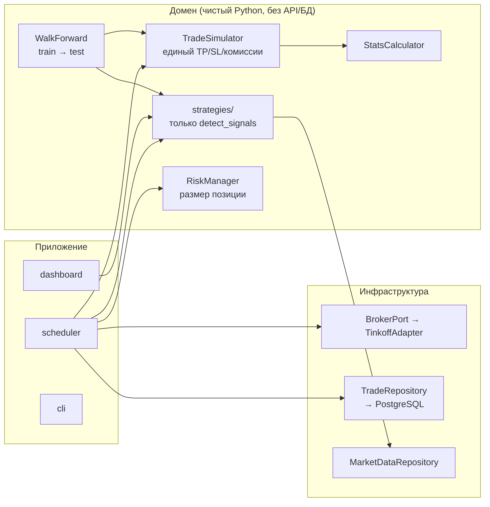

# Архитектура p_selima_v8.1

Документ описывает фактическое состояние кода на момент создания (см.
`docs/CHANGELOG.md`). Всё, что помечено **ДЕФЕКТ**, проверено по коду.

---

## 1. Назначение системы

Автоматизированная торговля акциями/фьючерсами/валютой на Московской бирже через
T-Invest API:

1. **Сбор данных** — свечи 30m/1h/4h/1d/1w из API в PostgreSQL.
2. **Бэктест** — прогон стратегии по истории, расчёт PnL, комиссий, метрик.
3. **Live-торговля** — по сигналу на закрытии свечи: расчёт лота, маркет-ордер,
   Take Profit (лимит), Stop Loss (стоп-лимит), запись в БД.
4. **Сопровождение** — сбор ID стоп-ордеров, сверка статусов с биржей, закрытие
   сделок в БД по факту исполнения TP/SL.
5. **Визуализация** — Dash-дашборд: свечи, индикаторы, уровни, таблица сделок.

---

## 2. Точки входа

| Файл | Роль | Запуск |
|---|---|---|
| `main.py` | smoke-тест: токен, счета, загрузка свечей | `python main.py` |
| `scheduler.py` | **production**: автоторговля, 3 задачи по приоритетам | `python scheduler.py` |
| `scheduler_notifier.py` | то же, но вместо сделок — уведомления в VK | `python scheduler_notifier.py` |
| `dashboard/app.py` | актуальный Dash-дашборд (пакет) | `python -m dashboard.app` |
| `app_dashboard.py` | **legacy** монолит-дашборд (~1800 строк), дублирует `dashboard/` | `python app_dashboard.py` |
| `reload_data.py`, `reload_data_v2.py` | загрузка/перезагрузка истории | `python reload_data_v2.py` |
| `dry_run_signal_check.py`, `dual_ma_signals*.py` | разовая проверка сигналов | вручную |
| `scripts/*`, `optimization/*`, `debug/*` | утилиты, не production | вручную |

Планировщик — единственный процесс, который пишет реальные ордера.

---

## 3. Дерево проекта

Легенда: **[C]** — ядро (production), **[T]** — инструмент/скрипт, **[L]** — legacy/архив,
**[D]** — документация/конфиг.

```
p_selima_v8.1/
├── AGENTS.md                          [D] правила и карта для AI-агентов: маршрут чтения, инварианты
├── README.md                          [D] обзор, установка, запуск, env
├── pyproject.toml                     [D] зависимости, Python 3.12, ruff/mypy/pytest
├── uv.lock                            [D] зафиксированные версии (коммитится)
├── requirements.txt                   [D] генерируется `uv export`, руками не правится
├── vendor/t_tech_investments-*.whl    [D] SDK T-Invest (официальный индекс недоступен)
├── .env.example                       [D] шаблон переменных без значений
├── .gitignore / .dockerignore         [D]
├── .github/workflows/ci.yml           [D] CI: ruff + mypy + pytest («чистый набор» + все тесты)
├── main.py                            [T] smoke-тест брокера
├── scheduler.py                       [C] автоторговля: P0/P1/P2
├── scheduler_notifier.py              [C] сигналы + VK, без сделок (~1060 строк)
├── app_dashboard.py                   [L] legacy-дашборд-монолит (~1794 строки)
├── candle_patterns.py                 [L] старый модуль паттернов в корне
├── check_data_db.py                   [T] проверка содержимого БД
├── reload_data.py / reload_data_v2.py [T] загрузка истории (v2 — актуальная)
├── export_aflt_candles.py             [T] выгрузка свечей AFLT
├── inspect_client.py                  [T] инспекция клиента API
├── dual_ma_signals.py                 [T] поиск сигналов Dual MA
├── dual_ma_signals_dashboard_aligned.py [T] то же, выравнивание с дашбордом
├── dry_run_signal_check.py            [T] проверка сигналов без торговли
├── test_check.py                      [T] скрипт-проверка загрузки свечей (не pytest)
├── test_balance_check.py              [T] проверка баланса/маржи (не pytest)
├── dual_ma_trades.csv, report.html    [L] артефакты, не код
│
├── config/                            [D]
│   ├── __init__.py
│   ├── instruments.json               [C] список инструментов: figi, ticker, enabled, timeframes
│   ├── trading_config.py              [C] лимиты: max_positions_per_account=6, min_position_size
│   ├── trading_mode.py                [C] TRADING_MODE=dry_run|live (+LIVE_CONFIRM), по умолчанию dry_run
│   ├── commissions.py                 [C] комиссии: 0.05% за операцию, маржинальные брекеты
│   └── costs.json                     [C] издержки бэктеста по инструментам: спред/проскальзывание (ADR-016)
│
├── src/
│   ├── __init__.py                    пакет
│   │
│   ├── market_data/                   [C]
│   │   ├── models.py                  dataclass Candle (OHLCV + is_complete + candle_source)
│   │   ├── timeframe.py               Enum Timeframe: 30m/1h/4h/1d/1w → CandleInterval
│   │   ├── history_manager.py         PostgreSQL: чтение/запись свечей, дедупликация, кэш
│   │   ├── data_updater.py            обёртка: full_reload(), incremental_update(), instruments.json
│   │   └── candle_loader.py           загрузка свечей (вспомогательный)
│   │
│   ├── strategies/                    [C]
│   │   ├── base_strategy.py           BaseStrategy, Signal, Trade, StrategyStats + PnL/комиссии/MFE/MAE
│   │   ├── strategy_registry.py       `@register_strategy` + ленивое автообнаружение пакетов (ADR-014)
│   │   ├── strategy_factory.py        StrategyFactory.create(code, timeframe, config, debug)
│   │   ├── indicators_builder.py      SMA/EMA/MA Adaptive/RSI/MACD/BB/ATR/Stochastic
│   │   ├── indicators_config.py       периоды индикаторов
│   │   ├── levels_builder.py          построение уровней поддержки/сопротивления
│   │   ├── levels_config.py           параметры кластеризации уровней
│   │   ├── levels_detector.py         детектор экстремумов v1 (устарел)
│   │   ├── levels_detector_v4.py      v4 (устарел)
│   │   ├── levels_detector_v5.py      v5 — используется дашбордом
│   │   ├── levels_detector_debug.py   отладочная версия
│   │   ├── extremums_config.py        параметры экстремумов
│   │   ├── patterns_config.py         конфиг свечных паттернов
│   │   ├── sma_crossover_strategy.py  [L] старая версия SMA-стратегии
│   │   ├── sma_crossover_config.py    [L] её конфиг
│   │   ├── candle_pattern_strategy.py [L] старая версия паттернов
│   │   ├── simple_ma_strategy.py      [L] простой пример стратегии
│   │   ├── mfi_bb_strategy.txt        [L] стратегия в виде текста, не кода
│   │   ├── sma_crossover/             [C] пакет: config.py, strategy.py, signal_validator.py
│   │   ├── _template/                 [C] шаблон новой стратегии: config.py, strategy.py (в реестр не попадает)
│   │   └── dual_ma_crossover_after_testing/  [C] пакет: config.py (TP/SL по тикерам), strategy.py
│   │
│   ├── sma_crossover/                 [L] КОПИЯ src/strategies/sma_crossover/ (идентична)
│   │
│   ├── candle_patterns/               [L] паттерны: config, strategy, signal_validator, patterns/
│   │
│   ├── brokers/                       [C]
│   │   ├── base.py                    AbstractBroker: get_accounts, get_candles, ...
│   │   ├── sdk_broker.py              TinkoffSDKBroker (t_tech.invest.Client)
│   │   ├── broker_factory.py          BrokerFactory.create("sdk"|"grpc")
│   │   ├── account_info.py            информация о счёте
│   │   ├── position_calculator.py     расчёт размера позиции по свободной марже
│   │   ├── position_manager.py        TradeParameters: лоты, lot_value, маржа, лимит позиций
│   │   └── trade_executor.py          маркет-ордер + TP (лимит) + SL (стоп-лимит)
│   │
│   ├── trading/                       [C]
│   │   ├── models.py                  LiveTrade, TradeStatus, OrderType, build_signal_key()
│   │   ├── repository.py              LiveTradeRepository (SQLite, legacy)
│   │   ├── stop_order_models.py       StopOrderRecord, StopOrderStatus
│   │   ├── stop_order_repository.py   StopOrderRepository (SQLite, legacy)
│   │   ├── pg_repository.py           PgLiveTradeRepository / PgStopOrderRepository (PostgreSQL);
│   │   │                              create_pending_if_absent() — идемпотентность по signal_key
│   │   ├── orchestrator.py            TradingOrchestrator.process_signals()
│   │   ├── account_selector.py        LONG/SHORT → account_id из env
│   │   ├── order_collector.py         сбор ID стоп-ордеров после открытия
│   │   ├── pending_recovery.py        дозакрытие зависших PENDING по состоянию биржи (ADR-013)
│   │   └── reconciler.py              сверка API → БД, закрытие сделок
│   │
│   ├── analytics/strategy_analyzer.py [C] метрики, интерпретация, отчёт по результату стратегии
│   ├── backtest/
│   │   ├── simulator.py               [C] TradeSimulator, ExitRules, SizingRules — единый цикл TP/SL
│   │   │                                  (SL-first, гэпы по open, exit_time = конец бара,
│   │   │                                   уровни от сырого open, ADR-012/ADR-017)
│   │   ├── costs.py                   [C] CostModel: спред (½ на сторону), проскальзывание,
│   │   │                                  tp_penalty (чувствительность), метки GROSS/NET (ADR-016)
│   │   ├── walk_forward.py            [C] окна train/test, отбор параметров на train, OOS-прогон (ADR-015)
│   │   └── backtester.py              [L] отдельный движок бэктеста (не используется стратегиями)
│   ├── storage/models.py              [L] устаревшая ORM-модель "marketdata"
│   └── utils/
│       ├── crypto.py                  [C] Fernet: encrypt/decrypt/hash account_id
│       └── masking.py                 [C] mask_account_id() для логов
│
├── tests/                             [C] pytest
│   ├── test_strategy_contract.py      контракт BaseStrategy: live-методы, паритет сигналов
│   ├── test_trading_mode.py           разбор TRADING_MODE / LIVE_CONFIRM
│   ├── test_signal_idempotency.py     signal_key: стабильность, повторный сигнал не создаёт сделку
│   ├── test_pending_recovery.py       дозакрытие зависших PENDING (ADR-013)
│   ├── test_trade_simulator.py        TradeSimulator: вход/TP/SL/гэпы/размер позиции/entry_filter
│   ├── test_walk_forward.py           walk-forward: окна, изоляция параметров, warmup, пропуск окон
│   ├── test_costs.py                  издержки: спред/проскальзывание, TP-лимитка, конфиг, GROSS/NET
│   └── test_allow_short_parity.py     backtest и live одинаково соблюдают allow_short
│
├── dashboard/                         [C] актуальный дашборд
│   ├── app.py                         точка входа: Dash, init data layer
│   ├── config.py                      TIMEFRAME_MAP, LEVELS_CONFIG, MIN_CANDLES_FOR_STRATEGY
│   ├── data.py                        доступ к HistoryManager, маппинг ticker↔figi
│   ├── compute.py                     прогон стратегии, подготовка сделок
│   ├── callbacks.py                   регистрация Dash-callback'ов
│   └── ui/{components,chart_builder,layout}.py   компоненты, графики (881 строка), layout
│
├── migrations/                        [T] ручные миграции (SQLite: add_hash, lot_size, position_id,
│                                          stop_orders, constraint; PostgreSQL: add_signal_key)
├── scripts/                           [T] экспорт сделок/свечей, отчёт, top10 по объёму,
│                                          таблица FIGI, проверка constraint,
│                                          pnl_baseline.py (baseline PnL до/после правок движка),
│                                          walk_forward.py (OOS-оценка TP/SL),
│                                          cost_audit.py (разложение Δ PnL по слоям, bootstrap-CI)
├── optimization/                      [T] grid_tp_sl_dual_ma.py, optimize_macd_plus.py,
│                                          _check_db.py, tz_ml_optimization.md (ТЗ на ML)
├── debug/                             [T] debug_margin.py, debug_instrument.py
├── archive/                           [L] старый дашборд, web_dashboard, marketdata.db
├── data/live_trades.db                SQLite со сделками (в .gitignore)
├── logs/                              логи (в .gitignore)
└── docs/                              [D] эта документация
```

---

## 4. Компоненты и связи



По умолчанию и `scheduler.py`, и `scheduler_notifier.py` пишут сделки и стоп-ордера в
PostgreSQL (`PgLiveTradeRepository` / `PgStopOrderRepository`). SQLite-репозитории
(`repository.py`, `stop_order_repository.py`) остались только для legacy-скриптов и
локальных проверок.

### Ключевые зависимости

| Компонент | Зависит от | Используется в |
|---|---|---|
| `BaseStrategy` | `Candle`, `config.commissions` | все стратегии, `StrategyFactory` |
| `TradeSimulator` | `Candle`, `Signal`, `Trade`, `CostModel` | `BaseStrategy.execute_trades()` |
| `CostModel` (`costs.py`) | `config/commissions.py`, `config/costs.json` | `TradeSimulator`, `scripts/*` |
| `StrategyFactory` | `strategy_registry` | scheduler, dashboard |
| `HistoryManager` | `AbstractBroker`, SQLAlchemy | `DataUpdater`, dashboard, скрипты |
| `DataUpdater` | `HistoryManager`, `BrokerFactory`, `instruments.json` | scheduler |
| `TradingOrchestrator` | `PositionManager`, `TradeExecutor`, `LiveTradeRepository` | `strategy.execute_live_trades()` |
| `OrderCollector` | `LiveTradeRepository`, `StopOrderRepository`, API | scheduler (P1) |
| `TradingReconciler` | оба репозитория, API | scheduler (P2, startup) |
| `AccountSelector` | env | scheduler |

---

## 5. Поток данных стратегии



Два независимых пути исполнения:

- **Бэктест**: `strategy.run(candles)` → `detect_signals()` → `TradeSimulator.run()`
  (вход по `open` следующей свечи, TP/SL по `high`/`low`) → `calculate_stats()`.
- **Live**: `check_last_signal()` → `execute_live_trades(orchestrator, ...)` → API.

Правила выхода задаются один раз: `ExitRules` в `TradeSimulator`, TP/SL — из конфига
стратегии. Критерии входа — `detect_signals()` плюс `entry_filter()` (хук на свече
исполнения). `allow_short` соблюдается всеми тремя путями: симуляцией,
`check_last_signal()` и `execute_live_trades()`.

Модель исполнения (ADR-012) — пессимистичная там, где OHLC не даёт ответа:

| Ситуация | Правило |
|---|---|
| свеча задела TP и SL | исполняется SL |
| свеча открылась за уровнем SL | выход по `open` (хуже уровня) |
| свеча открылась за уровнем TP | выход по `open` (лучше уровня) |
| время выхода | конец бара (`open_time + bar_duration`) |

Уровни TP/SL строятся от **сырого** `candle.open`; издержки меняют только цену
исполнения, поэтому набор сделок не зависит от модели издержек (ADR-017). Флаг
`levels_from_fill=True` повторяет live-конвенцию (уровни от факта исполнения) и
используется только для чувствительности. `Trade.exit_reason` различает `TP`, `SL`,
`GAP` и `TIME` (позиция открыта на конец периода), `exit_type` — тип заявки.

PnL считается тремя слоями: `pnl_price` (сырые цены) → `pnl_after_market_costs`
(спред и проскальзывание) → `pnl_net` (минус комиссия и маржа). `COMMISSION_MODE`
читается из окружения: `NONE` делает GROSS-прогон действительно gross.

Используются разные модели: `Trade` (симуляция) и `LiveTrade` (реальная торговля),
см. `docs/STRATEGY_CONTRACT.md`.

---

## 6. Торговый цикл планировщика

| Задача | Приоритет | Cron | Функция |
|---|---|---|---|
| Обновление данных | P0 CRITICAL | каждую минуту, сек. 5, часы 5–23 и 0 | `update_market_data` |
| Запуск стратегий | P0 CRITICAL | `*/30`, сек. 15, часы 5–23 и 0 | `run_trading_strategies` |
| Сбор стоп-ордеров | P1 IMPORTANT | `*/2` мин | `collect_stop_orders` |
| Мониторинг позиций | P2 BACKGROUND | `*/3` мин | `monitor_open_positions` |

При старте выполняется `_startup_reconcile()` — сначала `PendingRecovery` (зависшие
PENDING), затем сверка стоп-ордеров; закрывает сделки, исполненные пока процесс был
остановлен. `PendingRecovery` вызывается также в P2 перед сверкой: PENDING-записи без
`position_id` не видны ни сверке, ни сборщику ордеров (ADR-013).

**ДЕФЕКТ:** комментарии в коде обещают «05:00–00:30» и «каждые 15 минут», фактически
`hour="5-23,0"` (до 00:59) и `minute="*/3"` (каждые 3 минуты). Источник истины — cron.

Приоритеты реализованы через `threading.Lock`, но `max_instances=1` у APScheduler уже
сериализует задачи; `can_run_task()` проверяет `critical_lock.locked()` без захвата.
Практический эффект приоритетов близок к нулю.

### Режим торговли

`config/trading_mode.py` → `resolve_trading_mode()`:

| `TRADING_MODE` | `LIVE_CONFIRM` | Поведение |
|---|---|---|
| не задан / `dry_run` | — | сигналы находятся и логируются, ордера не отправляются |
| `live` | не `yes` | `TradingModeError` на старте процесса |
| `live` | `yes` | реальные ордера |

`TEST_MODE=true` подменяет рыночные сигналы фиктивными (для проверки процесса).

---

## 7. Хранилища

### PostgreSQL (рыночные данные)

Таблица `market_data` (модель `MarketData` в `src/market_data/history_manager.py`):

| Колонка | Тип | Примечание |
|---|---|---|
| id | BigInteger PK | |
| figi | String(50) | индекс |
| ticker | String(50) | индекс |
| timeframe | String(10) | `30m`/`1h`/`4h`/`1d`/`1w` |
| open_time | DateTime(timezone=True) | **MSK** после `_convert_utc_to_msk` |
| open/high/low/close | Numeric(14,6) | |
| volume | BigInteger | |
| is_complete | Boolean | |
| candle_source | Integer | 0 UNSPECIFIED, 1 EXCHANGE, 2 DEALER_WEEKEND |

`UNIQUE (figi, timeframe, open_time)`. Схема создаётся не приложением, а вручную
(`Base.metadata.create_all` закомментирован).

### PostgreSQL (сделки и стоп-ордера)

Основное хранилище для `live_trades` и `stop_orders`: `PgLiveTradeRepository` /
`PgStopOrderRepository` (`src/trading/pg_repository.py`).

Идемпотентность live-сигналов (ADR-010):

| Объект | Назначение |
|---|---|
| `live_trades.signal_key` | `figi\|timeframe\|candle_open_time\|direction`; NULL у старых записей |
| `uq_live_trades_signal_key` | частичный уникальный индекс `WHERE signal_key IS NOT NULL` |

`create_pending_if_absent()` выполняет `INSERT ... ON CONFLICT (signal_key) WHERE
signal_key IS NOT NULL DO NOTHING` **до** отправки ордера. `rowcount = 0` означает, что
сигнал уже обработан (в этом или предыдущем запуске процесса) — ордер не отправляется.

Если процесс упал после вставки PENDING, но до записи OPEN, остаётся сделка без
`position_id`, невидимая сверке. Её разбирает `PendingRecovery` (ADR-013):
`get_stale_pending()` → сверка с портфелем и операциями → OPEN, CANCELLED (с
освобождением ключа) или «нужна ручная проверка» (ключ сохраняется).

Схема: `_ensure_schema()` проверяет наличие колонки и индекса через `information_schema` /
`pg_indexes` (прав владельца не требует) и вызывает DDL только если объект отсутствует.
На рабочей БД владелец таблиц — отдельная роль, поэтому изменение схемы выполняется
заранее: `migrations/migrate_add_signal_key.py` под владельцем.

Подключение: драйвер задаётся явно — `postgresql+psycopg2://` (SQLAlchemy 2.1 по
умолчанию выбирает `psycopg` v3, который не установлен).

### SQLite (сделки, legacy)

Не используется production-кодом (`scheduler.py`, `scheduler_notifier.py` работают через
PostgreSQL). Оставлен для legacy-скриптов и локальных проверок.

`live_trades` — `trade_id` (PK, текст), `position_id`, `strategy_name`, `timeframe`,
`ticker`, `figi`, `direction`, `signal_key` (только PG), `entry_time/price`, `lots`,
`lot_size`, `position_size`, `exit_time/price/type`, `pnl_abs/percent`, `tp_price/sl_price`,
`tp_percent/sl_percent`, `status` (PENDING/OPEN/CLOSED/FAILED/CANCELLED), `account_id`
(Fernet), `account_id_hash`, `orders_collected`, `error_message`, `metadata` (JSON).

`stop_orders` — `stop_order_id`, `position_id`, `trade_id`, `order_type` (TP/SL),
`stop_price`, `status` (ACTIVE/EXECUTED/CANCELLED/EXPIRED), `metadata` (JSON).

Схема создаётся в `LiveTradeRepository._create_table()`, изменения — вручную через
`migrations/*.py`. Alembic не используется.

### Расхождения

- `src/storage/models.py` описывает таблицу `marketdata` (без `figi`, `time` вместо
  `open_time`) — **не используется**, конфликтует с реальной схемой.
- `pg_repository.py` дублирует SQLite-репозитории «один-в-один» по интерфейсу;
  SQLite-версии выведены из production-пути, но ещё не удалены (T2-4).

---

## 8. Безопасность

| Место | Проблема | Уровень |
|---|---|---|
| ~~`src/utils/crypto.py:29-30`~~ | ~~при отсутствии ключа логирует сгенерированный `ACCOUNT_ENCRYPTION_KEY`~~ **Исправлено (T0-2):** ключ больше не генерируется и не логируется, при отсутствии — `ValueError` с командой генерации | — |
| ~~`src/trading/account_selector.py:49-53`~~ | ~~`debug`-лог печатает полный `account_id`~~ **Исправлено (T0-2):** `src/utils/masking.py::mask_account_id` → `***1234`, применено также в `orchestrator`, `position_manager`, `trade_executor`, `account_info` | — |
| ~~`scheduler.py:39`, `scheduler_notifier.py:51,59`~~ | ~~`DRY_RUN = False`, `LIVE_TRADING = True` захардкожены~~ **Исправлено (T4-5):** режим только из `TRADING_MODE` (по умолчанию `dry_run`), `live` требует `LIVE_CONFIRM=yes`; в `dry_run` ордера не отправляются | — |
| `history_manager.py:54-58`, `pg_repository.py:32-37` и др. | пароль PostgreSQL в URL; SQLAlchemy может вывести URL в лог ошибки | высокий |
| `dashboard/app.py:75` | `app.run(debug=True)` — Werkzeug debugger = RCE при внешнем доступе | высокий при публикации |

Правило проекта: секреты только в `.env`, в логи не попадают.

---

## 9. Известные дефекты (проверено по коду)

### Блокирующие запуск

1. ~~`src/strategies/strategy_registry.py:17-27` — 9 импортов несуществующих пакетов.~~
   **Исправлено (T0-1):** в реестре остались `sma_crossover` и
   `dual_ma_crossover_after_testing`, отсутствующие коды перечислены в TODO-комментарии.
   **T3-6 (ADR-014):** ручные импорты убраны совсем — стратегии регистрируются
   декоратором, реестр обнаруживает пакеты лениво; несуществующий пакет в списке
   теперь невозможен.
2. ~~`scheduler.py:33`, `scheduler_notifier.py:45` — импорт отсутствующего
   `src.strategies.dual_ma_crossover`.~~ **Исправлено (T0-3):** оба модуля импортируют
   существующий пакет `dual_ma_crossover_after_testing`. Импорт отсутствующего пакета
   остался только в одноразовых скриптах — см. п. 22a.
3. ~~`scheduler.py:463,512` вызывает `strategy.check_last_signal()`, а `scheduler.py:558` —
   `strategy.execute_live_trades()`; у `dual_ma_crossover_after_testing/strategy.py`
   этих методов **нет**.~~ **Исправлено (T0-3):** методы реализованы в `BaseStrategy`,
   `scheduler.py` и `scheduler_notifier.py` импортируют существующий пакет
   `dual_ma_crossover_after_testing`.
4. ~~Нет `src/__init__.py`, `src/strategies/__init__.py`, `src/backtest/__init__.py`,
   `src/storage/__init__.py`.~~ **Исправлено (T0-5).**

### Логика

5. `scheduler.py:463` и `:512` — `check_last_signal()` вызывается дважды за итерацию.
6. ~~`base_strategy.py:208,221` — `self.allow_short` присваивается дважды.~~
   **Исправлено (T3-3):** присваивание одно.
7. `base_strategy.py:293-294` — `total_pnl_percent` делится на `initial_balance`, хотя
   `total_pnl` считается по фактическим позициям; при `position_size_percent < 100`
   доходность занижена.
8. `base_strategy.py:382-383` — Sharpe берёт `closed_trades[0]` без сортировки по времени.
9. `base_strategy.py:390-406` — Z-score считается по несортированному списку сделок.
10. ~~`execute_trades()` в каждой стратегии: `position_size = current_balance`
    (`position_size_percent` игнорируется), одна позиция одновременно, `exit_time`
    равен `candle.open_time` (время выхода некорректно), TP и SL проверяются в одной
    свече без приоритета «что раньше» (всегда TP первым — оптимистично).~~
    **Исправлено (T3-3, T3-5, ADR-011, ADR-012):** цикл вынесен в `TradeSimulator`,
    `position_size_percent` учитывается, при касании обоих уровней исполняется SL,
    гэп исполняется по `open`, `exit_time` — конец бара. Осталось (T3-5d, T2-7):
    одна позиция одновременно, нет проскальзывания внутри бара.
10a. ~~`dual_ma_crossover_after_testing`: фильтр `max_adaptive_deviation_percent`
    применяется только в `execute_trades`, поэтому live может открыть сделку, которую
    бэктест отклоняет.~~ **Частично исправлено (T3-3):** фильтры вынесены в
    `entry_filter()`, который вызывается на свече исполнения — той же, что видит
    бэктест. Остаточное расхождение: live не знает `open` следующей свечи на момент
    сигнала, поэтому `check_last_signal()` фильтр не применяет (T3-4, `EntryPolicy`).
10b. ~~`TradeSimulator._try_entry` строил TP/SL от `entry_price` с издержками, поэтому
    включение спреда/проскальзывания меняло уровни, набор сделок (52 → 53) и «−39%» PnL.
    Метка GROSS при этом не была gross: комиссия и маржа вычитались всегда.~~
    **Исправлено (T2-7a, ADR-017):** уровни от сырого `open`, три слоя PnL, `exit_reason`,
    `COMMISSION_MODE` из env, `scripts/cost_audit.py`. Чистые издержки рынка SBER 4h —
    −6.9% от gross (−1 652.70 ₽); OOS-expectancy bootstrap-CI включает ноль (54 сделки).
10c. ~~`config/commissions.py` начислял маржу на всё тело позиции и минимум за один день
    (`max(1, days)`), поэтому позиция на собственные средства платила за перенос.
    У CRU6 стоял `tick_size = 0.01` вместо 0.001 ₽, тиковые издержки были завышены в 10 раз.~~
    **Исправлено (T2-7a, ADR-018):** плата только на непокрытую часть, порог 5 000 ₽,
    `margin_nights()` = 0 для внутридневной сделки, `MARGIN_SHORT_UNCOVERED` (дефолт
    `True` — консервативно, сверка с отчётом брокера — T2-17), `config/costs.json` v2.
    SBER 4h net 16 600.73 ₽ (было 16 724.98 ₽ по неверной модели); CRU6 net 3 475.33 ₽.
11. `config/commissions.py:41` — `COMMISSION_MODE = "SHORT_ONLY"` глобально; бэктест
    LONG не учитывает комиссии, сравнение стратегий некорректно.
    **Частично закрыто (T2-7, ADR-016):** спред и проскальзывание теперь учитываются
    (`src/backtest/costs.py`), а отчёт показывает комиссию отдельной строкой и помечает
    нулевую модель как GROSS. **T2-7a (ADR-017):** режим читается из `COMMISSION_MODE`
    (env), `NONE` отключает комиссию полностью; три слоя PnL разделяют цену, издержки
    рынка и комиссию. Глобальный режим по умолчанию (`SHORT_ONLY`) остаётся: перевести
    его в конфиг стратегии — отдельная задача.
12. `config/trading_config.py:13` — `max_positions_per_account = 6`, а
    `docs/PROJECT_DOCUMENTATION.md` и docstring `orchestrator` говорят про 3.
13. Смешаны naive и aware datetime: API отдаёт UTC, `HistoryManager` конвертирует в MSK
    (aware), сделки пишутся `datetime.now()` (naive, локальное время).

### Дублирование и мусор

14. `src/sma_crossover/` ≡ `src/strategies/sma_crossover/` (полная копия).
15. `src/candle_patterns/` vs `src/strategies/candle_patterns/` (вторая отсутствует в копии).
16. `app_dashboard.py` (1794 строки) vs пакет `dashboard/` — два дашборда.
17. `src/strategies/sma_crossover_strategy.py` + `sma_crossover_config.py` — старые версии
    рядом с пакетом.
18. `src/strategies/levels_detector{,_v4,_v5,_debug}.py` — 4 версии одного детектора.
19. ~~`config/config.py` — пустой файл.~~ **Удалён (T0-6).**
20. `src/backtest/backtester.py` — свой `Trade`/`Order`, не связан с `BaseStrategy`.
20a. ~~`optimization/grid_tp_sl_dual_ma.py` подбирает TP/SL на той же истории, на которой
    потом отчитывается, — метрики систематически завышены.~~ **Закрыто (T2-8, ADR-015):**
    `src/backtest/walk_forward.py` + `scripts/walk_forward.py` — отбор параметров на train,
    оценка только на OOS-периодах. Скрипт подбора не удалён, но его результат больше
    не считается доказательством.
21. `scheduler.py` (855) и `scheduler_notifier.py` (1060) — почти полные дубликаты.
22. 20+ одноразовых скриптов в корне (`check_data_db.py`, `inspect_client.py`,
    `export_aflt_candles.py`, `test_*.py`, ...).
22a. Импорт отсутствующего `src.strategies.dual_ma_crossover` в одноразовых скриптах:
    `dry_run_signal_check.py:22`, `dual_ma_signals.py:29`,
    `dual_ma_signals_dashboard_aligned.py:35`, `optimization/grid_tp_sl_dual_ma.py:30`,
    `scripts/export_dual_ma_to_postgres.py:41`, `scripts/export_dual_ma_trades.py:36`.
    Скрипты не запускаются; перевести на `dual_ma_crossover_after_testing` или
    переместить в `archive/` (T1-3).
23. `src/brokers/position_manager.py:271-299` — недостижимый блок после `return`
    (там же `F821: remaining_positions` — имя не определено). Мёртвый код, удалить.

### Инфраструктура

24. ~~Нет `pyproject.toml` / `requirements.txt` / lock-файла — зависимости не
    воспроизводимы.~~ **Исправлено (T0-4):** `pyproject.toml` + `uv.lock` +
    сгенерированный `requirements.txt`, SDK вендорен в `vendor/` (см. ADR-009).
25. Нет CI, `test_*.py` в корне — скрипты с побочными эффектами при импорте (не pytest).
    Каталог `tests/` создан (T0-3), покрытие пока только контракт стратегий.
26. Нет Docker (`Dockerfile`, `docker-compose.yml`, healthcheck).
27. Рабочая копия не является git-репозиторием.
28. `ruff check src` — 134 замечания на момент T0-2 (baseline, не исправлялись):
    `UP045`/`UP006` (typing → PEP 604/585), `I001` (порядок импортов), `F401`, `E722`.

---

## 10. Целевая архитектура (предложение)



Ключевые изменения (детали — `docs/DECISIONS.md`):

1. **Тонкий контракт стратегии**: стратегия отдаёт только сигналы. Всё остальное
   (TP/SL, размер позиции, комиссии, MFE/MAE, статистика) — в общем движке.
2. **Один репозиторий сделок** (PostgreSQL) + Alembic.
3. **pydantic-settings** вместо `os.getenv` в 15 местах.
4. Разделение `app/` (запуск), `domain/` (логика), `infra/` (адаптеры).

---

## 11. Как читать этот проект

1. `src/strategies/base_strategy.py` — контракт `Signal`/`Trade` и вся математика PnL.
2. `src/strategies/dual_ma_crossover_after_testing/strategy.py` — эталон «стратегия +
   симуляция в одном файле» (то, что предлагается разделить).
3. `src/trading/orchestrator.py` — путь реального ордера.
4. `scheduler.py` — расписание и сборка компонентов.
5. `docs/STRATEGY_CONTRACT.md` — как писать новую стратегию.
